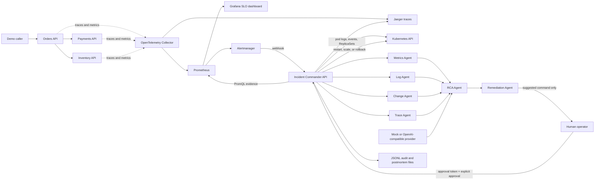
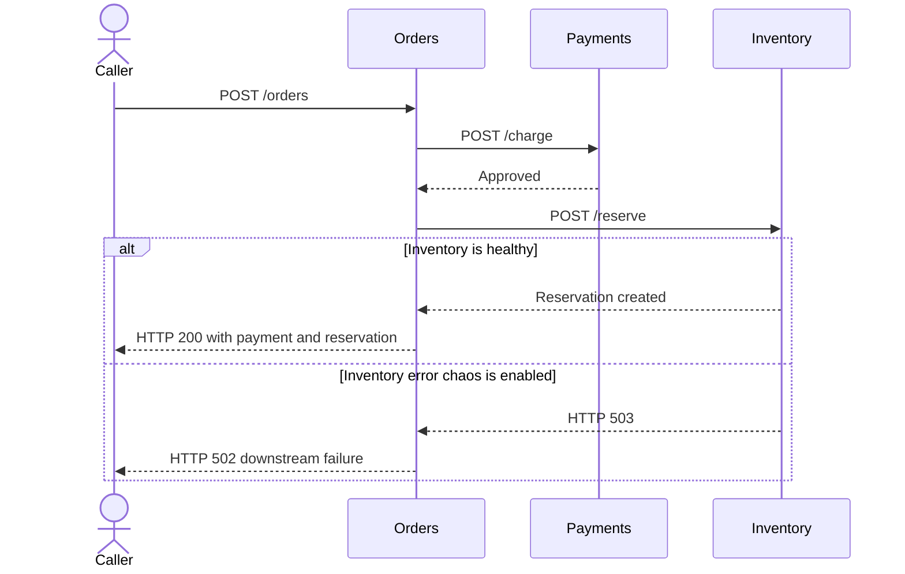
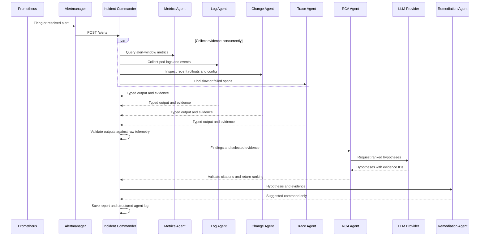
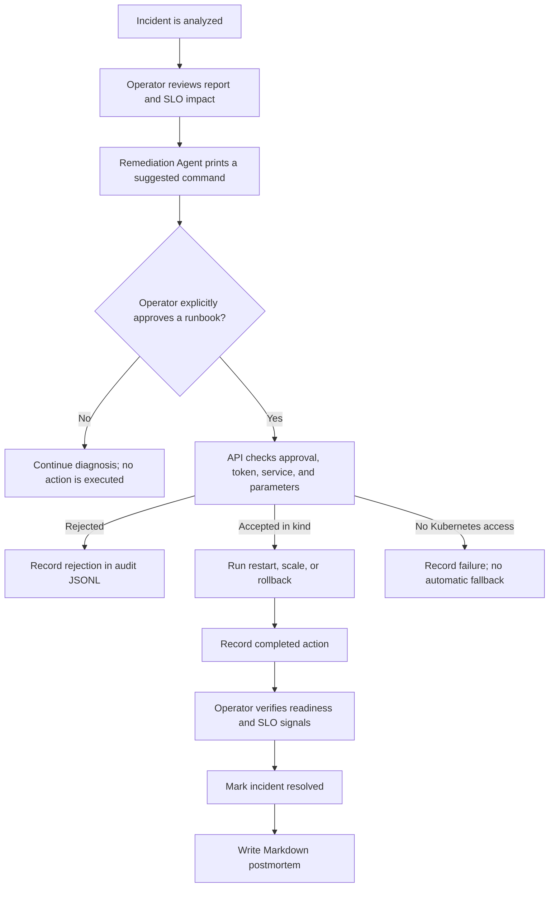
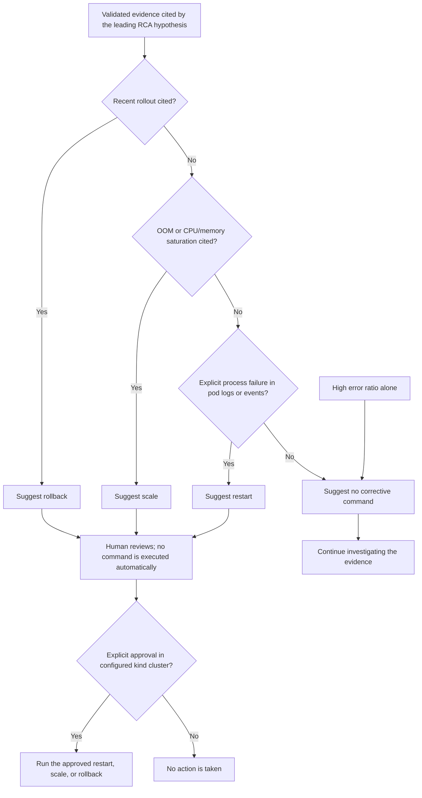
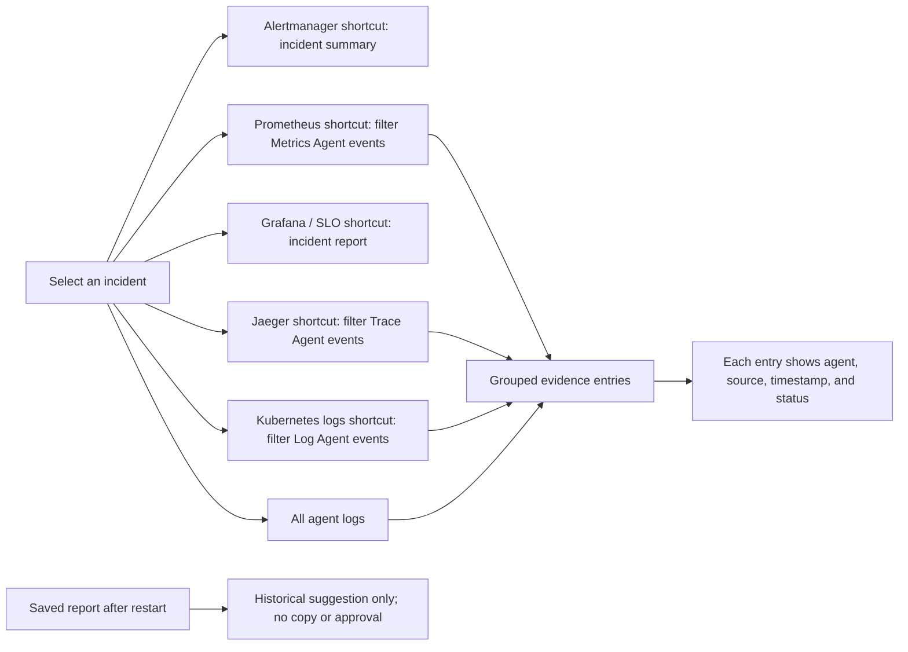

# SRE Incident Commander

A local-first SRE incident-response demo built with Python 3.11, FastAPI, Docker
Compose, OpenTelemetry, Prometheus, Grafana, Alertmanager, and an optional local
Ollama model. It demonstrates how a service failure can be injected, observed,
investigated with cited telemetry, and documented without allowing an alert or an
LLM to execute remediation.

The project has four main parts:

1. **A small service path:** Orders charges Payments and reserves stock through
   Inventory. Bounded chaos settings can inject errors, latency, or memory pressure.
2. **Observability and SLOs:** The services export request metrics and traces.
   Prometheus evaluates availability, p95 latency, and error-budget burn rules;
   Grafana displays the service signals.
3. **Evidence-backed investigation:** Alertmanager sends firing alerts to the
   Incident Commander. Metrics, Log, Change, and Trace Agents collect evidence in
   parallel; the RCA Agent checks citations and ranks hypotheses through a mock or
   OpenAI-compatible LLM provider.
4. **Human-controlled response:** The Remediation Agent suggests a command only.
   Separate restart, scale, and rollback runbooks require explicit approval and
   write an audit record. Resolved incidents can produce a Markdown postmortem.

See the [local operations guide](docs/USER_GUIDE.md) for setup, navigation,
verification, and troubleshooting.
Review [limitations and design trade-offs](docs/LIMITATIONS_AND_TRADEOFFS.md)
before exposing the demo beyond a trusted local environment.

## Architecture



### Order request and chaos flow



### Alert investigation flow



### Human-approved remediation lifecycle



### Evidence-based remediation decision



Only evidence cited by the leading validated hypothesis is considered.
Metrics that confirm customer impact, without evidence of a cause, do not justify
a generic restart.

Services and the observability stack run in Docker Compose. The same application
images and observability configuration can be deployed to a local kind cluster.
In Compose, Kubernetes evidence collection is explicitly disabled and reported as
such; the kind deployment enables collection of pod status, logs, events, and
rollout history. Compose is the recommended first run; Kubernetes remediation
requires a configured kind cluster and still requires explicit operator approval.

## Prerequisites

- Docker Desktop with its Linux container engine and the Docker Compose v2 plugin.
- Python 3.11 for local tests, CLI use, and development; the application images
  already include Python 3.11.
- Optional: Ollama and a downloaded model for local LLM-backed RCA. The mock
  provider runs without Ollama or an API key.
- Optional: `kind` and `kubectl` for the Kubernetes deployment.
- GNU Make is optional. Commands in the [local operations guide](docs/USER_GUIDE.md)
  use PowerShell and do not require Make.

## Local Compose

```powershell
if (-not (Test-Path .env)) { Copy-Item .env.example .env }
# Edit .env and set a random APPROVAL_TOKEN before using runbook actions.
docker compose up --build -d
docker compose ps
```

The default provider is `mock`. To use Ollama, configure the OpenAI-compatible
provider in `.env`; the guide includes the exact settings. For the full startup,
stop, and verification walkthrough, see [docs/USER_GUIDE.md](docs/USER_GUIDE.md).

Service endpoints:

| Component | Address |
|---|---|
| Incident Commander API | http://localhost:8000 |
| Incident Commander Swagger UI | http://localhost:8000/docs |
| Orders API | http://localhost:8001 |
| Orders Swagger UI | http://localhost:8001/docs |
| Payments API | http://localhost:8002 |
| Inventory API | http://localhost:8003 |
| Prometheus | http://localhost:9090 |
| Alertmanager | http://localhost:9093 |
| Grafana | http://localhost:3000 (`admin` / `sre-local-only`) |
| Jaeger traces | http://localhost:16686 |

### Incident dashboard

Open [http://localhost:8000/](http://localhost:8000/) to review analyzed and
saved incidents, read the investigation report and structured agent logs, and
inspect the RCA evidence and suggested command. Saved reports remain available
after a container restart; their recommendations are shown as historical
suggestions and cannot be approved from the dashboard. Use **Copy command** only
for a current incident suggestion; archived recommendations are not re-evaluated
under the current policy.

The dashboard's Prometheus, Grafana/SLO, Jaeger, and Alertmanager shortcuts stay
within the selected incident: they jump to its metrics, report, trace events, or
incident summary instead of opening monitoring homepages. The configured LLM
ranks RCA hypotheses, while the remediation command follows separate evidence
rules. Rollback requires cited rollout evidence, scale requires saturation, and
restart requires an explicit process failure; a high error ratio alone does not
justify a restart.

The Compose setup does not provide Kubernetes credentials, so Kubernetes
runbook approvals are unavailable there. In the kind deployment, a separate
approval form is shown only when Kubernetes access and an approval token are
configured. It requires explicit confirmation and records the outcome in the
audit log. See the [user guide](docs/USER_GUIDE.md#navigate-the-application) for
the dashboard walkthrough.

### Incident dashboard evidence navigation



Submit an order:

```powershell
Invoke-RestMethod -Method Post -Uri http://localhost:8001/orders `
  -ContentType 'application/json' -Body '{"item_id":"widget","quantity":2}'
```

The `/chaos` endpoint on each service accepts `off`, `latency`, `error`, or
`memory`. Injection expires automatically. Latency is capped at 5 seconds,
per-request memory allocation at 32 MiB (at most two concurrent allocations), and
the configuration TTL at five minutes. For example:

```powershell
Invoke-RestMethod -Method Post -Uri http://localhost:8003/chaos `
  -ContentType 'application/json' -Body '{"mode":"error","ttl_seconds":60}'
Invoke-RestMethod -Method Post -Uri http://localhost:8001/orders `
  -ContentType 'application/json' -Body '{"item_id":"widget","quantity":1}'
```

The failed order returns HTTP 502 because inventory returns the injected HTTP 503.
Turn chaos off explicitly with `{"mode":"off"}` or let its TTL expire.

Run the end-to-end demo after the stack is healthy:

```powershell
python scripts/demo.py
```

The demo injects bounded Inventory errors, confirms Orders returns HTTP 502, and
repeats requests until Prometheus records a nonzero error ratio. It then submits a
representative firing Alertmanager webhook, prints the investigation, and submits
a resolved webhook. Generated reports and JSONL logs are written under
`./artifacts`. The demo sends a synthetic webhook directly because the configured
multi-window burn-rate alerts intentionally require longer observation windows.
The chaos setting is explicitly turned off after the metric wait, including when
that wait fails.

## kind

Build the images, create the cluster, load the images, and apply the stack:

```powershell
docker compose build
kind create cluster --name sre-incident-commander --wait 120s
kind load docker-image sre-orders:local sre-payments:local sre-inventory:local sre-incident-commander:local --name sre-incident-commander
kubectl create namespace sre
kubectl create secret generic incident-commander-approval -n sre `
  --from-literal=token='replace-with-a-random-token'
kubectl apply -k .
kubectl get pods -n sre
```

The namespace and secret commands should be run only after checking whether
they already exist. To update the token, use
`kubectl create secret ... --dry-run=client -o yaml | kubectl apply -f -`
and restart the Incident Commander Deployment.

Port-forward the services you want to inspect (use separate terminals):

```powershell
kubectl port-forward -n sre service/orders 8001:8000
kubectl port-forward -n sre service/incident-commander 8000:8000
kubectl port-forward -n sre service/grafana 3000:3000
kubectl port-forward -n sre service/prometheus 9090:9090
kubectl port-forward -n sre service/jaeger 16686:16686
```

The Kubernetes manifests set CPU/memory requests and limits, readiness/liveness
probes, and a namespace-scoped service account. The Incident Commander role can
read pods, logs, events, ConfigMaps, Deployments, and ReplicaSets. It can patch
Deployments in the project namespace for the named runbook actions. Replace the
demo Grafana password before using the manifests outside a disposable local cluster.

## SLOs and telemetry

- **Availability SLI:** successful requests / all requests, using the custom
  `app_requests_total{service,status_code}` counter.
- **Availability SLO:** 99.5% for each service.
- **Latency SLI:** p95 from the `app_request_duration_seconds` histogram. The
  starter warning threshold is 500 ms; tune it to your workload before treating
  it as a production SLO.
- **Fast burn:** error-budget burn >14.4x over both 5 minutes and 1 hour.
- **Slow burn:** error-budget burn >6x over both 30 minutes and 6 hours.

Prometheus recording rules and alerts are in
[observability/prometheus/rules.yml](observability/prometheus/rules.yml).
Grafana provisions the dashboard from
[observability/grafana/dashboard.json](observability/grafana/dashboard.json).
Traces are exported by the Collector to Jaeger.

## Incident analysis and safeguards

`POST /alerts` receives Alertmanager's webhook. The orchestrator runs typed
Metrics, Log, Change, and Trace Agents concurrently; each output is checked
against its collected raw telemetry before the RCA Agent sees it. Metrics use a
Prometheus query-range adapter (including alert dependencies and CPU/memory
saturation queries); `MetricsBackend` is the seam for a future Dynatrace adapter.
The Log Agent analyzes redacted pod logs and Kubernetes events, the Change Agent
correlates Deployments/ReplicaSets/ConfigMaps, and the Trace Agent queries Jaeger
for slow and failing spans. The RCA Agent then ranks cited hypotheses, followed
by a Remediation Agent that suggests a manual command only and never executes it.
Each agent's structured input/output is appended to `agent-events.jsonl`.
Evidence and RCA calls use a provider selected with `LLM_PROVIDER=mock|openai`.
The default mock needs no key. `openai` uses an OpenAI-compatible Chat Completions
endpoint and can target hosted services or local Ollama. The application requires
a non-empty `LLM_API_KEY` in this mode; Ollama can use a placeholder such as
`ollama`. Logs are redacted for common credential patterns before they are sent
to the configured provider. Only the alert name, service, timestamps, summary,
and description are forwarded from the alert payload. Review data-handling
requirements before enabling a hosted provider.

Hypotheses must cite evidence IDs returned by the collectors. Validation rejects
unknown citations and checks that deployment, latency, error-ratio, availability,
memory, and database claims match the cited raw evidence. The response is a ranked
hypothesis—not a verified cause—and must be reviewed by an operator. Each firing
alert writes a Markdown investigation report with per-agent findings, RCA
citations, manual command/risk, and available SLO impact. Print it with:

```powershell
python -m incident_commander.cli show <incident_id>
```

In Compose, `incident_id` is the Alertmanager fingerprint returned by `POST /alerts`.
Metrics and trace backends report unavailable samples as warnings when the
corresponding Prometheus/Kubernetes metrics or traces are not present.

When Alertmanager reports an analyzed alert as resolved, the service writes a
Markdown postmortem with the alert timeline, available SLO samples, cited
hypotheses, and follow-up actions. `POST /incidents/{fingerprint}/resolve` can
also generate one with an operator-provided summary and corrective actions.
Incident state is held in process memory, so a process restart before resolution
loses the pending analysis; use durable storage before extending this beyond a
portfolio demo.

### Human-approved runbooks

Set `APPROVAL_TOKEN` in `.env` before starting Compose. The approval endpoint
rejects requests when the token is unset or incorrect, requires
`{"approved":true}`, validates the service and replica count, and records
requests, denials, failures, and completed actions in `artifacts/audit.jsonl`.
These approval-gated actions are separate from the Remediation Agent's suggestion:
that agent only prints a proposed `kubectl` command and cannot invoke the API.
The CLI also requires typing `APPROVE`:

```powershell
$env:APPROVAL_TOKEN = 'the-same-value-as-in-.env'
python -m incident_commander.cli restart inventory --approver "Your Name"
python -m incident_commander.cli scale orders --replicas 2 --approver "Your Name"
python -m incident_commander.cli rollback payments --approver "Your Name"
```

Detailed preconditions and verification steps are in
[runbooks/remediation.md](runbooks/remediation.md). No alert can execute these
actions automatically.

## Tests and development

```powershell
python -m pip install -r requirements-dev.txt
python -m pytest
python -m ruff check .
python -m ruff format --check .
docker compose config --quiet
kubectl kustomize .
```

If GNU Make is installed, `make help` lists shortcuts for the same common tasks.
CI runs Ruff, pytest, and builds all four application images on Python 3.11.

## Results

Fill this section with measured results from your environment; do not use
unmeasured sample numbers.

| Measure | Result | Environment / method |
|---|---:|---|
| Orders steady-state p95 | _TBD_ | _TBD_ |
| Orders availability during demo | _TBD_ | _TBD_ |
| Alert-to-analysis time | _TBD_ | _TBD_ |
| Hypothesis supported by operator review | _TBD_ | _TBD_ |
| Image size / startup time | _TBD_ | _TBD_ |


# Limitations and Design Trade-offs

SRE Incident Commander is a local portfolio demo, not a production incident
management system. Its safeguards and observability illustrate useful patterns,
but do not replace production identity, security, persistence, or operational
controls.

## Known limitations

### Local trust boundary

- Docker Compose binds published ports to `127.0.0.1`, which keeps them local to
  the host by default. The dashboard, incident read APIs, and alert webhook do
  not authenticate users, so do not change the bindings to expose the stack to
  an untrusted network.
- The runbook endpoint checks a shared `APPROVAL_TOKEN` and an approval
  confirmation. The typed approver name is not an identity check. The audit
  JSONL file is local and is not tamper-proof.
- Compose uses a published demo Grafana credential. Replace it before sharing
  the stack or using it outside a disposable local environment.
- Secret redaction covers common credential patterns, not every form of
  personal or sensitive data. Review telemetry and provider data-handling
  requirements before sending evidence to a hosted LLM.

### Evidence and diagnosis

- Kubernetes evidence collection is disabled in Compose. Pod logs, Kubernetes
  events, and rollout history require the kind deployment; they are reported as
  unavailable rather than inferred.
- Traces depend on the request having produced spans and Jaeger retaining them
  for the queried time range. Missing traces reduce evidence but do not prove
  that a service is healthy.
- RCA hypotheses are generated from the collected evidence and validated
  citations. A valid citation does not prove causation, and model confidence is
  not calibrated as a probability of root-cause correctness.
- The 99.5% availability objective, latency threshold, recording rules, and
  burn-rate windows are illustrative defaults. Tune them to a real service's
  traffic, measurement window, and user impact before relying on them.

### LLM behavior

- The mock provider is deterministic test scaffolding, not an RCA model.
  Ollama or another OpenAI-compatible provider can produce different rankings
  for the same evidence.
- The provider asks for structured JSON and makes one correction attempt when
  the response does not match the schema. If validation still fails, analysis
  fails explicitly; it does not silently substitute mock output.
- Only cited telemetry is passed to the RCA ranking, but evidence can be
  incomplete, stale, noisy, or insufficient to distinguish a symptom from a
  cause.

### Remediation and approval

- Remediation is rule-based and deliberately narrow: rollback requires cited
  rollout evidence, scale requires resource-saturation evidence, and restart
  requires an explicit process-failure signal. A high error ratio alone is not
  enough to recommend a restart; some incidents therefore have no corrective
  command.
- The Remediation Agent only suggests commands. Execution is separate, requires
  explicit approval, and is available only when Kubernetes access and the
  approval token are configured. Compose does not provide Kubernetes access.
- The runbooks cover only restart, scale, and rollback. They do not verify
  application-level recovery or replace an operator's judgment.

### State and retention

- Active incident state is held in process memory. After an application restart,
  saved reports remain readable, but archived recommendations are historical
  and cannot be copied or approved as current actions.
- Compose stores reports, postmortems, and JSONL logs under the ignored local
  `artifacts/` directory. Agent inputs and outputs are appended without an
  automatic retention or rotation policy, so this directory can grow large and
  may contain operational telemetry. Do not commit it.
- The kind deployment mounts incident data on `emptyDir`; data is lost when the
  pod is replaced. Prometheus and Jaeger also have no persistent storage
  configured in the starter Compose stack.
- These services are single-instance demo components: there is no HA,
  disaster-recovery plan, or tested backup/restore procedure.

## Design choices and trade-offs

| Choice | Benefit | Cost or limitation |
|---|---|---|
| Docker Compose first, with kind manifests | Quick local startup and a path to exercise Kubernetes APIs | Compose cannot provide pod/change evidence or runbooks; kind requires extra setup |
| Local Ollama and a pluggable provider interface | Local inference can avoid sending telemetry to a hosted model; adapters can be swapped | Model latency and output quality vary; hosted providers require a separate data review |
| Typed agent schemas, telemetry validation, and exact evidence citations | Rejects malformed or unsupported findings before RCA uses them | Valid evidence can still be incomplete and citations cannot establish causation |
| Deterministic, human-approved runbooks | Predictable, reviewable actions with an audit trail; no LLM execution | Only a few evidence patterns and actions are supported; uncertain incidents may get no command |
| Markdown reports and JSONL agent/audit logs | Easy to inspect, replay, and include in a portfolio demo | No indexing, retention, tamper-proof audit storage, or efficient long-term querying |
| In-memory active state with saved read-only reports | Minimal infrastructure and safe behavior after restart | Approval context is not reconstructed from archived reports |
| Synthetic telemetry fixtures and short local SLO windows | Fast, repeatable tests and demos | They do not represent production traffic or certify SLO behavior |

## Before broader use

Add authentication and TLS, restrict network exposure, replace demo credentials,
use a secrets manager, persist and rotate state/logs, define identity-bound
approvals, test recovery and backups, and evaluate model behavior against
representative incidents. Keep remediation human-approved unless a separate,
well-tested production control plane is introduced.
